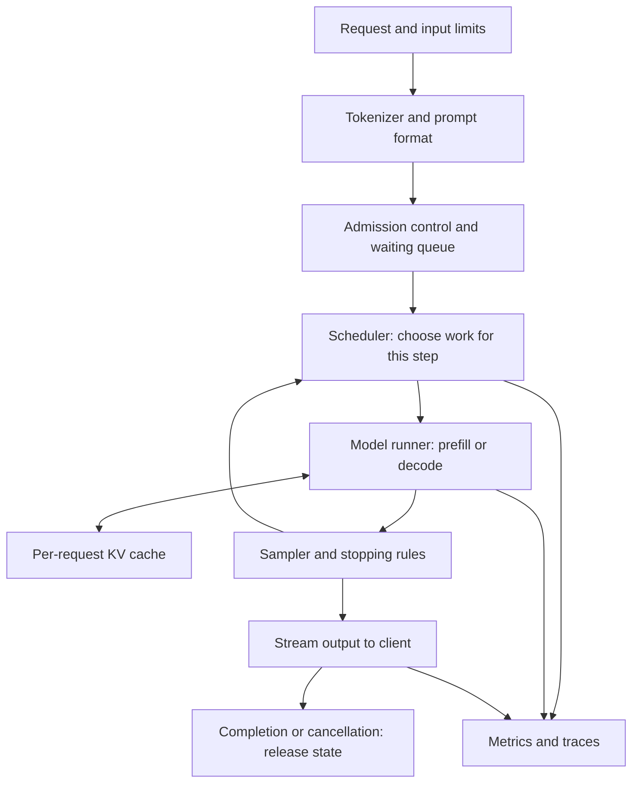

# Build, measure, explain: LLM inference and infrastructure

Prepared for an engineer with five years of ML/programming experience and a laptop. This is a project curriculum, not a list of courses. Plan on roughly 16–20 weeks at 8–10 hours per week; this is an estimate, and the correctness gates matter more than the calendar. No GPU rental is needed for the core path.

## The outcome

You will build a small, understandable inference runtime, verify a pretrained model against a reference, serve concurrent requests, measure behavior under load, and publish a series that explains the work to both engineers and general readers. The goal is engineering judgment: knowing which bottleneck matters, which change addresses it, and what evidence supports that decision.

Three things evolve together:

1. **Engine:** model forward pass → token loop → KV cache → batching → scheduler → cache allocator → service.
2. **Engineering evidence:** numerical parity → reproducible measurements → workload experiments → failure tests → capacity report.
3. **Writing:** a reader's question → a simple explanation → your experiment → an honest limitation.

The included `tiny-inference` folder is an initial mechanics lab, not the completed curriculum. It runs a real tiny decoder with random, untrained weights. Meaningful text, pretrained checkpoint loading, batching, paging, and HTTP serving are future milestones.

## Visual learning is part of every milestone

Use the [visual learning companion](visual-learning-companion.md) alongside this roadmap. Each milestone includes a data-flow diagram, a step-through animation where state changes matter, and a visual experiment grounded in the implementation. Begin with the four interactive scenes in the chat: generation, causal attention, KV-cache growth, and continuous batching.

For each diagram, first predict the next state, then advance the animation, then inspect the corresponding code. Label tensor shapes, positions, ownership, and allocations. For each blog post, extract a simpler view that still preserves the important causal relationships. Distinguish illustrative animations from actual engine traces and measured timing.

## The system you are learning

**Model** means parameters plus an architecture. **Runtime/engine** means the code that executes it and manages generation. **Server** adds an API, request lifecycle, scheduling, and streaming. **Infrastructure** adds deployment, routing, capacity, monitoring, rollout, and recovery. A fast matrix operation does not by itself make a reliable service.

For a standard autoregressive decoder, **prefill** processes the input prompt and supplies logits for the first generated token. **Decode** then repeatedly processes newly selected tokens. Previously computed attention keys and values can be reused. The cache saves recomputation, but occupies memory and still has to be read. See the [Hugging Face cache explanation](https://huggingface.co/docs/transformers/main/en/cache_explanation).

## Tools and hardware decisions

Use **Python** for the main project. Begin with the supplied NumPy implementation to inspect every tensor; move the model runner to PyTorch for reference comparisons and later accelerator work. Keep tokenization, scheduling, storage, and serving interfaces separate from the numerical backend. Add C++ or Rust only after measurements identify a reason to replace a component.

Use **GPT-2 small** as the first pretrained compatibility target. Its architecture is documented, its checkpoint is modest, and it is suitable for inspecting a complete forward pass. It is a text completion model, not a modern chat assistant. Use a second, small decoder with RoPE/RMSNorm/GQA only after the first implementation is correct. The [model card](https://huggingface.co/openai-community/gpt2) and [architecture documentation](https://huggingface.co/docs/transformers/en/model_doc/gpt2) are the sources of truth for that milestone.

For a laptop with tight RAM, stay with the tiny configuration longer and keep prompts short. GPT-2's roughly 124 million parameters need about 0.50 GB for FP32 weights alone; loading copies, framework overhead, cache, and temporary tensors add memory. Do not infer total RAM requirements from weights alone. You do not need to train a model to learn inference.

If you have Apple Silicon, CPU is the reproducible starting point; Metal/MPS acceleration can become a separate comparison. Apple GPU results do not establish CUDA kernel or multi-GPU performance. On any laptop, control background work, thread counts, and power state during measurements. Never interpret a scheduler simulation as a hardware throughput result.

Read [llama2.c](https://github.com/karpathy/llama2.c) for a compact implementation and [llama.cpp](https://github.com/ggml-org/llama.cpp) for a mature C/C++ runtime after implementing your own baseline. Treat them as learning references, not projects you need to reproduce feature for feature.

## Weekly working rhythm

Allocate about two hours to reading and diagrams, four to implementation, two to experiments, and one to writing. For every optimization, save a brief decision record:

> Workload → observed bottleneck → proposed mechanism → correctness condition → controlled measurement → downside → keep/revert decision.

Keep five artifacts throughout: a runnable engine, regression checks, raw benchmark results, short design decisions, and blog drafts. Do not move to a new optimization while the previous change has unexplained output differences.

## Milestone 1 — Establish a measurable baseline

**Suggested time:** week 1. **Question:** What exactly happens between input IDs and output IDs?

Learn only the inference-specific refreshers you need: tensor dimensions, causal attention, logits versus probabilities, greedy versus stochastic decoding, and the distinction between weights and request state.

**Build and experiment:**

1. Run the included tests and both generation modes. Read `forward()` before `generate()`.
2. Draw the shapes for embeddings `[T,D]`, Q/K/V `[H,T,D/H]`, attention scores `[H,T,T]`, and logits `[T,V]`.
3. Change prompt length and output length separately. Save the raw timings.
4. Record OS, CPU, RAM, Python, numerical library, BLAS implementation, thread settings, seed, and exact code version.
5. Run a pretrained reference model separately when you have its dependencies and checkpoint. Keep tokenization and model timing separate.

**Done when:** you can identify the first-token path and every subsequent-token path, reproduce a result, and explain why random-weight output says nothing about language quality.

**Write:** “What happens after you press Send?” Lead with the visible waiting period and streaming response, then introduce tokens as chunks of text rather than always whole words.

## Milestone 2 — Implement and verify a pretrained forward pass

**Suggested time:** weeks 2–3. **Question:** Can your own runner reproduce the reference model's logits?

**Build and experiment:**

1. Pin a checkpoint revision and reference-library version. Use the exact tokenizer and configuration shipped with it.
2. Implement GPT-2's token and learned-position embeddings, affine LayerNorm, attention projections and biases, causal masking, residual paths, MLP activation, final norm, and tied output head.
3. Map every checkpoint tensor to your module. Verify shapes and orientation rather than assuming similarly named parameters have the same layout; GPT-2's Conv1D-style projection storage is a common trap.
4. Disable dropout and gradients for the reference run. Start in FP32 on CPU.
5. Compare intermediate tensors layer by layer, then final logits on at least 20 fixed prompts, including punctuation, whitespace, and multilingual strings.
6. Track maximum absolute error and a scale-aware comparison. Start with explicit FP32 tolerances such as `atol=1e-4, rtol=1e-4`, investigate failures, and document any justified change. Near-zero values need an absolute tolerance.

**Done when:** intermediate and final values agree within justified tolerance and greedy sequences agree on the fixed suite. Matching readable text alone is not sufficient; close logits can yield different tokens near ties.

**Write:** “The model is a collection of numbers. What makes it answer?” Explain weights as learned settings, while avoiding claims that a particular weight stores a particular fact.

## Milestone 3 — Own the generation loop

**Suggested time:** week 4. **Question:** How does one prediction become an answer?

**Build and experiment:**

1. Implement greedy decoding, temperature, top-k, and top-p sampling with stable normalization.
2. Add output budgets, EOS, stop sequences, and a per-request random generator.
3. Stream text incrementally using the tokenizer's decoding behavior. Token boundaries may split bytes or text fragments; one token is not reliably one displayed word.
4. Check the context budget before accepting a request. Decide and document whether oversized input is rejected or explicitly truncated.
5. Test stop strings crossing token boundaries, zero output budget, EOS on the first token, and independent random streams for interleaved requests.

**Done when:** stopping behavior is predictable, greedy output matches your reference, and the same request seed is reproducible within the documented environment.

**Write:** “Why the same AI question can get different answers.” Separate sampling variation from variation caused by prompts, model versions, or execution details. Temperature is not a factual-accuracy dial.

## Milestone 4 — Add a KV cache without changing the answer

**Suggested time:** week 5. **Question:** Which computations can you reuse?

**Build and experiment:**

1. Reuse the starter's full-sequence-versus-cached comparison on your pretrained model.
2. Implement a contiguous cache with explicit capacity and current length. Compare preallocation with repeated concatenation.
3. Verify cache position offsets, single-token decode, and multi-token chunks after an existing prefix. A square prefill mask cannot be blindly reused for offset decode.
4. Sweep prompt lengths 16, 64, 256, and 512 where supported, keeping output length fixed. Measure local first-token latency, subsequent-token intervals, and allocated versus used memory.
5. Interleave two requests and prove their state remains isolated. Free state on completion and cancellation.

**Done when:** cached and uncached logits match at each step; the cache has explicit ownership; memory growth matches your calculation; performance claims include workload and machine.

**Write:** “The AI's scratchpad: why remembering earlier work can make replies faster.” State the analogy's limit: cached numerical intermediates are not a transcript, long-term memory, or a change to model weights.

## Milestone 5 — Build a performance model

**Suggested time:** week 6. **Question:** Is the bottleneck arithmetic, data movement, allocation, or Python overhead?

**Build and experiment:**

1. Profile matrix multiplications, attention, memory allocations/copies, normalization, and sampling. After the PyTorch port, use the [PyTorch profiler](https://docs.pytorch.org/tutorials/recipes/recipes/profiler_recipe.html).
2. Separate model loading, warmup, prefill, decode, and tokenization. Keep cold-start and warm results separate.
3. Predict weight and cache footprints before measuring. Explain any difference using temporary allocations and framework overhead.
4. Compare matrix-vector and batched matrix multiplication behavior. Change one variable at a time.
5. Use a roofline-style estimate: achievable performance is bounded by compute capability and memory bandwidth times arithmetic intensity. This is a bound, not a latency prediction.

**Done when:** you can account for the dominant costs in a measured workload and explain why an attractive optimization might not help it. Prefill is often more compute-intensive and small-batch decode often bandwidth-sensitive, but sequence length, batching, model architecture, and implementation can change the bottleneck.

**Write:** “Why a powerful computer can still feel slow.” Use moving ingredients versus preparing food as an analogy, then explain where the analogy stops.

## Milestone 6 — Batch requests correctly

**Suggested time:** week 7. **Question:** How much work can requests share without changing their meaning?

**Build and experiment:**

1. Add a batch dimension. Begin with equal lengths, then add padding and attention masks for unequal lengths.
2. Track each request's valid length, positions, generated tokens, stop state, and random state.
3. Implement a static batch baseline that holds its membership until completion.
4. Compare each batched request with the same request run alone, including short/long mixtures and requests that finish early.
5. Measure aggregate tokens/second and per-request latency together. Include wasted work on padding and finished slots.

**Done when:** per-request outputs are correct and you can show whether batching improves the chosen workload on your laptop. An asynchronous Python loop alone is not a batched model execution.

**Write:** “Serving one person quickly versus serving a crowd.” Explain that throughput and individual waiting time answer different questions.

## Milestone 7 — Continuous batching and admission control

**Suggested time:** weeks 8–9. **Question:** Which requests should get the next slice of computation?

**Build and experiment:**

1. Define states: waiting, prefilling, decoding, finished, cancelled, failed. Give each transition a clear owner.
2. Schedule at iteration boundaries. Admit new work as other requests finish, subject to token and cache budgets.
3. Start with FIFO; record enqueue time, admission time, first output, token timestamps, and completion.
4. Test a long request followed by short requests. Compare sequential, static batch, and continuous batch policies on the same arrival trace.
5. Bound the waiting queue. Define deadline expiry and overload rejection before adding retries.
6. Implement a deterministic scheduler simulation first, then connect it to actual batched forwards. Label simulation results separately from runtime measurements.

**Done when:** arrivals, completion, cancellation, and overload have predictable behavior; you can explain fairness and tail-latency tradeoffs using a trace.

**Write:** “How an AI service handles a queue.” Keep the distinction between waiting before service and slow generation during service.

## Milestone 8 — Manage cache memory in blocks

**Suggested time:** week 10. **Question:** How can a shared memory pool serve variable-length requests?

**Build and experiment:**

1. Create a fixed-size KV block pool, a free list, and a logical-to-physical block table per request.
2. Append tokens, allocate blocks on boundaries, reject insufficient capacity, and release blocks exactly once.
3. Test block boundaries, cancellation, allocation failure, reuse, and randomized request lifecycles. Assert allocated blocks plus free blocks equals pool capacity.
4. Compare the paged logical cache with the contiguous reference. On CPU, gather blocks into a dense view for the first implementation.
5. Measure internal waste in partially filled blocks and gather/copy overhead. Vary block sizes rather than declaring one universally optimal.

**Done when:** logits match the contiguous cache, blocks never belong to incompatible owners, and the pool returns to its initial free count after requests finish.

**Scope:** a block allocator with dense gather teaches paging semantics; it is not a high-performance PagedAttention kernel. Study the [PagedAttention paper](https://arxiv.org/abs/2309.06180) and [vLLM design](https://docs.vllm.ai/en/latest/design/paged_attention/) after building the allocator.

**Write:** “Why memory can run out before the computer runs out of work.” Use flexible storage units as an analogy for allocating space on demand.

## Milestone 9 — Reuse shared prefixes and schedule long prompts

**Suggested time:** week 11. **Question:** Can repeated context be reused without making other users wait?

**Build and experiment:**

1. Cache exact token prefixes. Include model revision, adapter/configuration identity, and other output-affecting settings in the cache identity.
2. Begin within one trust boundary. Define cache isolation before sharing across users.
3. Share only immutable blocks, reference-count them, and use copy-on-write for divergent continuations.
4. Split long prefills into bounded token chunks and interleave them with decode work.
5. Compare cache hits and misses, eviction policies, first-token latency, and inter-token stalls for mixed long/short traffic.

**Done when:** eviction and cancellation preserve other owners' blocks; unrelated requests cannot reuse invalid state; long prompts no longer monopolize scheduling without a measured reason.

**Write:** “When AI can reuse work—and when it must start again.” Similar-looking text is not necessarily an identical token prefix.

## Milestone 10 — Quantization as a measured tradeoff

**Suggested time:** week 12. **Question:** What can smaller numeric representations save, and what do they cost?

**Build and experiment:**

1. Implement a simple symmetric per-output-channel INT8 weight quantizer with scales and an explicit zero-row case.
2. Dequantize to FP32 for a correctness reference. Measure tensor storage and reconstruction error.
3. On the pretrained model, compare held-out negative log-likelihood/perplexity on a fixed, licensed text set and check representative prompts.
4. Compare against a backend with an actual supported quantized compute path. Record packing, scales, temporary buffers, and conversion overhead.
5. Treat weight quantization and KV-cache quantization as separate experiments.

**Done when:** the report separates smaller storage, peak runtime memory, speed, and output quality. A NumPy dequantize-then-matmul implementation does not demonstrate efficient INT8 inference and can be slower than FP32.

**Write:** “Can we make an AI model smaller without losing too much?” Explain approximating numbers, with actual quality evidence rather than a few pleasing examples.

## Milestone 11 — Build the serving boundary

**Suggested time:** week 13. **Question:** What happens when the client disconnects halfway through an answer?

**Build and experiment:**

1. Add a small HTTP service with streaming, request IDs, structured errors, input/output limits, deadlines, and a bounded queue.
2. Keep expensive model work under a model-worker/scheduler owner so request handlers do not block the event loop unpredictably.
3. Propagate cancellation from the connection to the scheduler and cache manager. Clean up in every terminal state.
4. Export request counts, errors, queue wait, first-token latency, token intervals, active requests, and cache occupancy. Compare metric definitions with [vLLM production metrics](https://docs.vllm.ai/en/latest/usage/metrics/).
5. Test malformed input, slow consumers, disconnects, deadline expiry, and worker failure. Avoid raw prompt logging by default; use IDs and numeric metadata for these labs.

**Done when:** no request leaks state after completion or cancellation, output streaming is bounded, and readiness reflects whether the model can actually serve.

**Write:** “Why a chatbot needs more than a model.” Focus on the user's experience of waiting, recovery, and interrupted connections.

## Milestone 12 — Operate and evaluate the complete system

**Suggested time:** weeks 14–16, with buffer through week 20. **Question:** Under what load can you keep a useful promise to users?

**Build and experiment:**

1. Freeze a workload containing short/long prompts, short/long outputs, repeated prefixes, and bursts. Record the exact arrival schedule.
2. Use closed-loop concurrency tests for one view and open-loop arrival-rate tests for another. A client that waits for responses can hide overload by reducing its own offered load.
3. Define a local experimental SLO before tuning, such as a first-token bound plus an inter-token bound. Choose thresholds after the baseline; they are not universal industry standards.
4. Ramp offered load. Report accepted, rejected, completed, failed, and deadline-missed requests together with latency percentiles and goodput.
5. Package a reproducible environment, pin dependencies/checkpoint revision, separate model download from readiness, and support graceful drain before shutdown.
6. Run failure drills: stop a worker, inject a load spike, fill the cache, delay a consumer, and restart with a cold model. Document symptoms, detection, recovery, and residual risk.
7. Compare with a mature local backend on the same model, tokenizer, prompt/output lengths, and decoding settings where supported. Explicitly list any mismatch in precision, cache policy, or model format.
8. Write a design report: architecture, invariants, performance evidence, failure behavior, limitations, and the next bottleneck.

**Done when:** another engineer can reproduce your results and understand when the engine should reject or queue work. A convincing portfolio has measured tradeoffs and correct cleanup, not just a long feature list.

**Write:** “Why AI slows down when everyone uses it at once” and “What building a tiny AI engine taught me.” Use real measurements and identify the laptop-scale scope.

## Optional accelerator and distributed track

Begin only after the laptop engine is correct and the measurement harness is useful. These can take another 4–8 weeks or longer; they are not required to finish the core project.

| Extension | Learn/build | Laptop preparation | Evidence requiring suitable hardware |
|---|---|---|---|
| GPU execution | Transfers, kernel launches, occupancy, synchronization, graph capture | Explain tensor layouts; isolate backend interface | Device timing, memory bandwidth, launch overhead |
| Attention kernels | Tiling, online softmax, fused attention | Derive blockwise softmax; compare math on tiny arrays | End-to-end gains with supported optimized kernels |
| Triton | Vector add → softmax → normalization → matmul | Read code and establish reference outputs | Compile/profile on a supported accelerator |
| Compilation | Static/dynamic shapes, compilation cost, warmup, graph breaks | Compare eager baseline and shapes | Verify target backend support and steady-state benefit |
| Speculative decoding | Draft proposals, verification, acceptance/correction | Implement greedy speculation with a deterministic mock draft | Speedups with a real draft/target pair and workload |
| Multiple replicas | Routing, independent queues, load balancing | Simulate requests and routing policies | Aggregate serving capacity and realistic failure behavior |
| Tensor/pipeline parallelism | Partitioning tensors/layers, collectives, communication | Derive tensor shapes and bytes per communication step | Multi-device latency and interconnect costs |
| Prefill/decode separation | Transfer KV state between specialized workers | Estimate transfer bytes and simulate queues | Network/transfer overhead versus specialization benefit |
| MoE and long context | Expert routing, skew, context partitioning | Work through routing and memory models | Expert/context parallel scaling with matching models |

Read the [FlashAttention paper](https://arxiv.org/abs/2205.14135) for reducing attention memory traffic through tiling. It does not make exact dense attention generally linear-time. Use [PyTorch SDPA](https://docs.pytorch.org/tutorials/intermediate/scaled_dot_product_attention_tutorial.html) before writing a fast attention kernel yourself. Work through the official [Triton tutorials](https://triton-lang.org/main/getting-started/tutorials/index.html).

For speculative sampling, read the [original speculative sampling paper](https://arxiv.org/abs/2302.01318): preserving the target distribution requires the correct acceptance and correction procedure, not simply keeping any plausible draft token. For distributed serving, use [vLLM's parallelism guide](https://docs.vllm.ai/en/latest/serving/parallelism_scaling/). A laptop simulation cannot verify these hardware speedups.

## Memory and latency calculations you should be able to do

For a conventional full-attention decoder, before sharding and without sliding-window eviction:

`KV bytes ≈ 2 × layers × sum(live sequence lengths) × KV heads × head dimension × bytes per element`

The two represents keys and values. For uniform lengths, replace the sum with `batch size × length`. Use KV heads rather than query heads for grouped-query attention. Page rounding, shared prefixes, quantization metadata, offload, and architectural differences change actual allocation.

Example, for an illustrative architecture: 24 layers, 8 KV heads, head dimension 64, 4096 cached tokens, and two-byte elements use `2 × 24 × 4096 × 8 × 64 × 2 = 201,326,592` bytes, or **192 MiB per sequence**. Eight such sequences use **1.5 GiB**, excluding weights and all other overhead. This is a calculation, not a measurement of a named model.

Weight storage is approximately `parameter count × bytes per parameter`, plus quantization metadata where applicable. Peak memory also includes cache, temporary activations, workspaces, allocator reserves, runtime state, and potentially duplicate copies during load. Unified memory does not remove the need for this budget.

| Metric | Definition for your project | Why it matters |
|---|---|---|
| Service TTFT | Client request send to first output token received | Includes transport, queuing, prefill, sampling, and delivery |
| Local TTFT | Generator start to first yielded token ID | Useful for the starter; excludes service overhead |
| Inter-token latency | Gap between successive received output tokens | Captures stalls while reading a streamed answer |
| Mean time per output token after first | `(last token time − first token time) / (output count − 1)` for at least 2 tokens | An average; does not show every stall |
| End-to-end latency | Send to completed response | Overall user wait |
| Output throughput | Total generated output tokens / wall time | Label aggregate versus per-request figures |
| Goodput | Completed requests satisfying the defined SLO / wall time | Rewards useful service, not just work performed |
| Queue wait | Scheduler admission time − enqueue time | Separates overload from slow execution |
| Memory | Used cache, reserved cache, and measured process/device memory | Different views answer different questions |

Percentiles need enough samples. Five repeats can describe local noise; they do not establish service p99. Preserve raw token timestamps and count errors/rejections rather than dropping slow or failed requests.

When paid infrastructure eventually becomes relevant, estimate `cost per successful request = total billed experiment cost / successful requests`, and separately state the SLO-qualified denominator. For token pricing comparisons, distinguish input/output tokens and include idle time and utilization. Use current provider prices at experiment time; this roadmap assumes no paid resources.

## The first three sessions

**Session 1, about 90 minutes:** run the starter tests; inspect the tensor shapes; compare cached and uncached generated IDs; draw where request state lives. Read the code's non-square causal mask comment and explain it in your own words.

**Session 2, about two hours:** benchmark prompt lengths 16, 64, and 128 with fixed output length. Write a prediction before each run. Compare cache used bytes with the formula. Explain why preallocation changes reserved memory even when few tokens are present.

**Session 3, about two hours:** plan the pretrained compatibility port. Make a tensor-by-tensor mapping checklist for GPT-2, then establish the trusted reference environment. Finish a draft of the first blog post before beginning performance optimization.

The next concrete engineering milestone is pretrained parity. Keep the NumPy implementation as a small, inspectable reference while the PyTorch backend grows.

## A senior engineering review checklist

- What workload and user promise are we optimizing for?
- What invariant proves the change preserves behavior?
- Which measured cost should decrease, and which new cost appears?
- Is this a model effect, a numerical effect, a runtime effect, or a queueing effect?
- What happens to short requests when a long request arrives?
- Who owns memory, and who frees it on every terminal path?
- Are results reproducible, and did we count failures and rejections?
- Is extra complexity justified by the measured benefit?
- Can someone operate and debug this without its original author?

References were checked on 3 October 2026. Live documentation can change; record the versions and commits actually used in each experiment. This curriculum's milestone order, workload suggestions, and acceptance criteria are a proposed learning design, not claims that any cited project uses this exact workflow.
